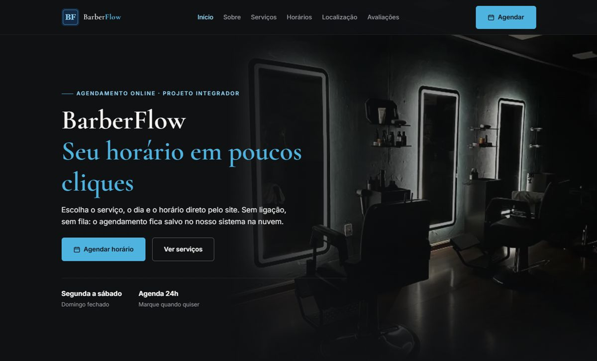
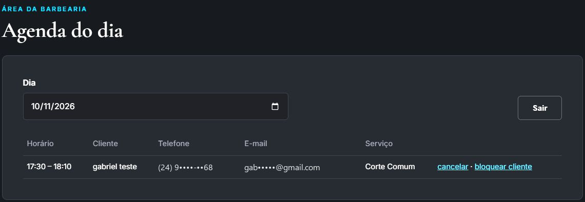
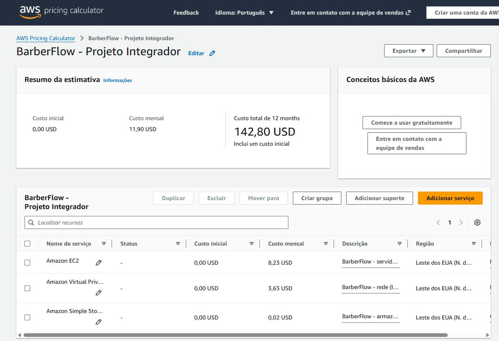

# BarberFlow

Sistema de agendamento online para barbearias, feito como **Projeto Integrador** do curso de Sistemas de Informação do Centro Universitário Dom Bosco (AEDB), em 2026, e publicado na **AWS** pelo AWS Academy Learner Lab.

Partimos do site de uma barbearia e acrescentamos o que faltava para ela atender sozinha pela internet:

- **Site** com serviços, preços e horários.
- **Agendamento online**: o cliente cria a conta, confirma o e-mail com um código de 6 dígitos, escolhe o serviço e o dia e só vê os horários livres. Ao confirmar, recebe outro e-mail com o horário marcado.
- **Painel do barbeiro**, protegido por senha: agenda de qualquer dia com o contato de cada cliente, opção de cancelar (libera a vaga na hora) e de bloquear quem abusa do sistema.

## Arquitetura na AWS

| Serviço | Para que serve |
| --- | --- |
| **EC2** (t3.micro, Amazon Linux) | Servidor: roda o site, a API em Node.js e o banco SQLite |
| **EBS** | Disco da EC2; guarda o banco entre uma sessão do lab e outra |
| **S3** | Guarda o pacote do site e a configuração de e-mail; a EC2 baixa a versão nova a cada boot |
| **IAM** (role da instância) | Dá à EC2 acesso ao S3 sem nenhuma chave escrita no código |
| **Security Group** | Firewall: libera só a porta 80 |
| **CloudShell** | Terminal no console da AWS que roda o script que cria tudo |

### O que tentamos e o que o laboratório permitiu

- **E-mail:** o plano era o Amazon SES, mas o Learner Lab bloqueia o serviço. Os códigos e confirmações saem pelo Gmail (SMTP).
- **Banco:** o plano inicial era o Amazon RDS, mas no lab ele continua cobrando com a sessão encerrada. Para o tamanho do sistema, o SQLite no disco da EC2 resolve.
- **Sem sub-rede privada e sem HTTPS:** sem banco separado, não há o que isolar; e o endereço muda a cada sessão, sem domínio para certificado.
- Numa conta AWS normal, trocaríamos o Gmail pelo SES e o SQLite pelo RDS.

### Custo

Pela calculadora da AWS, cerca de **US$ 11,90/mês** se ficasse ligado direto. No lab (orçamento de US$ 50), a EC2 só cobra enquanto está ligada e nada fica cobrando com o lab desligado (sem RDS, NAT ou load balancer).

## Segurança

Todas as regras são conferidas no servidor, não só na tela:

- só agenda quem confirmou o e-mail; o código vale 15 minutos e cai depois de 5 erros;
- um horário por cliente por vez, e dois clientes nunca pegam o mesmo horário (cada serviço ocupa o tempo que dura);
- senhas guardadas só como hash;
- limite de tentativas por rede contra robôs e quem tenta adivinhar senha.

## Telas

<table>
<tr>
<td width="50%"> Página inicial</td>
<td width="50%"> Agendamento confirmado</td>
</tr>
<tr>
<td> Painel do barbeiro (dados de teste)</td>
<td> Estimativa na calculadora da AWS</td>
</tr>
</table>

## Equipe

Projeto em grupo da turma de Sistemas de Informação (UniDomBosco, 2026), com participação de [Gabriel do Valle](https://github.com/gabrielvallecg) e [Pedro Henrique](https://github.com/Pedro-Osaka), entre outros integrantes.

O código-fonte não é público: o site partiu do layout de uma barbearia real. Esta página documenta o projeto e a arquitetura.
